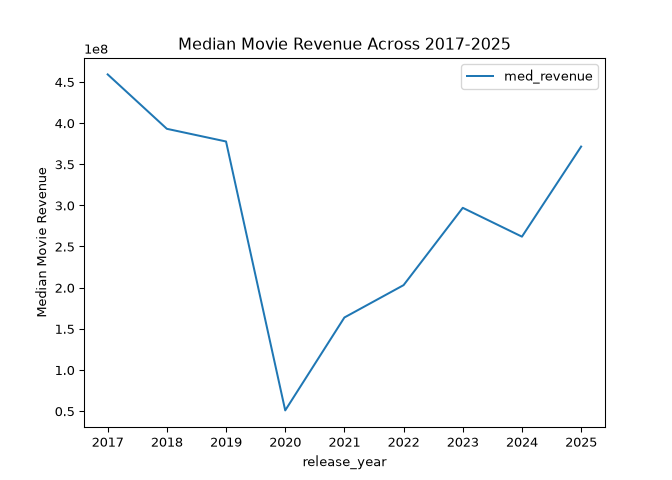
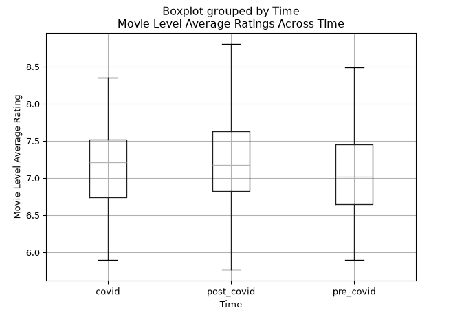
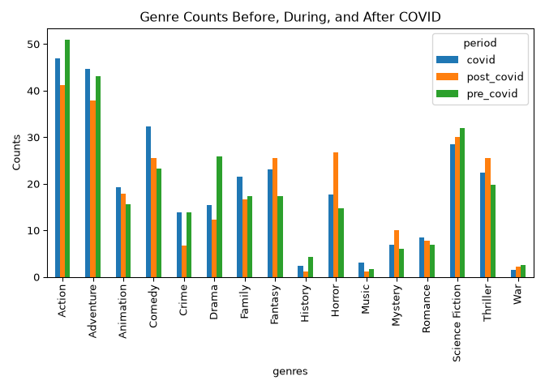

Did COVID Change the Profile of Popular Movies on TMDB?"

TODO - make readme that explains contents of the repo
TODO - clean up code
TODO - add links tources (do like see here, documentation, oscars, WHO)
TODO - publish page and make Quarto project

TODO - format this blog and prettify it

# Motivation

COVID-19 changed a lot of things in the world. For example, Zoom became a thing, and workplaces shifted to more hybrid and remote options. And we still see the effects of these changes today! With that in mind, I wanted to investigate whether the pandemic affected the movie scene. In particular, I wanted to see if there were any notable changes in movie ratings, the genres of movies being produced, and movie revenue. Using TMDB's API, I investigated how ratings, genre representation, and movie revenue differ among popular movies (according to TMDB) released before, during, and after COVID.

# Ethicality Checks
Before I analyzed the data, I reviewed TMDB's API terms and conditions to ensure I could use their data to answer this question. Upon reading them, I discovered that anyone using their API for any website must acknowledge the following: 

"This website uses TMDB and the TMDB APIs but is not endorsed, certified, or otherwise approved by TMDB."

I must also include their logo somewhere on the website where it can be easily seen. With that out of the way, because I am not using this data for commercial use, which they prohibit, I determined that it was ethical to use their data. In addition to this, I was polite with my requests by using Python's time module to pause for 0.05 seconds between each request, which is well below their limit of 40 requests per second.

# Collecting and Cleaning The Data
I used TMDB’s API documentation to learn how to structure my requests and choose filters to narrow my search. I queried their Discover Movies endpoint one release year at a time by setting a release date range and sorting the results by popularity in descending order. For each year, I requested three pages of results. These responses included movie IDs, which I then used to request each movie’s detailed information. I then extracted the movie fields relevant to my project, such as ratings, genres, runtime, budget, and revenue, and saved the records in a JSON file. Because I sorted by popularity, my dataset represents popularity-ranked TMDB results for each year, rather than a random sample of all movies. I then removed any movies without titles, movies with zero revenue (because the zero likely means that info is missing), movies less than 40 minutes (40 minutes is the minimum to be considered a feature film in the Academy Awards), and any movie with ratings based on fewer than 100 people.

After cleaning the data, I was left with 336 movies from 2017 to the present day (11/5/2026) with a total of 17 genres. For my analysis, I defined 2017-2019 as pre-COVID (I didn't want to include movies too far from COVID), 2020-2023 as during COVID (I included 2023 because that's when WHO officially declared the pandemic was no longer an international concern), and 2024 to the present day as post-COVID. The total number of movies in each time period from pre-, during, and post-COVID is 116, 130, and 90, respectively.

# Exploratory Data Analysis

Below are some highlights of my EDA that relate to how ratings, genre representation, and movie revenue differ among popular movies (according to TMDB) released before, during, and after COVID.

## Revenue

Among the popularity-ranked TMDB movies in my sample with nonzero reported revenue, the median revenue fell sharply in 2020, reaching a low of $50,788,409 and then rose through 2025, with some fluctuation year to year. I excluded 2026 because the year is incomplete. It is important to note that these are simply reported revenue numbers from my sample so the pattern does not show that COVID caused the drop. The revenue also isn't adjusted for inflation, but the drop is clearly there. 

## Movie-Level Average Ratings

TMDB reports an average vote rating for each movie. I compared these movie-level average ratings across the three periods. We see that there's no large visible difference in these movie-level average ratings for the most popular movies in those years despite the drop in revenue. The median of these movie-level rating averages for pre-, during, and post-COVID were 7.0165, 7.2105, and 7.1725, respectively.

## Genre Variety

I also took a look at genre distribution between these 3 time periods. I calculated the percentage of movies that fell in each genre for each of the 3 time periods. The percentages add up to more than 100 because most movies had 2-3 genres associated with them. Below is a bar plot of these percentages across each time period. The most visible difference is in horror, action, and drama films. From pre-, during, and post-COVID, the percentage of horror movies increased from 14.78 to 18.75 to 26.09; the percentage of action movies decreased from 51.30 to 45.31 to 41.30; and the drama percentages decreased from 27.83 to 15.63 to 13.04.

# Conclusion

Overall, the clearest change in the most popular movies (according to TMDB) across time was in reported revenue, showing a sharp decrease around 2020, then rising gradually. Movie ratings looked similar across the time periods, while genre distribution showed some changes but no complete change in the variety. Again, these results only describe this sample, and don’t show that COVID caused any of these patterns. It would be interesting to compare these results with inflation-adjusted revenue and with a sample that isn't selected by TMDB popularity.